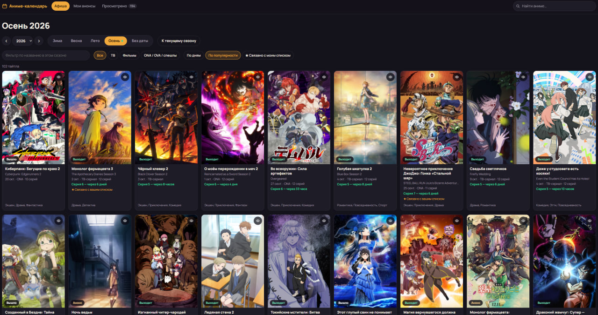
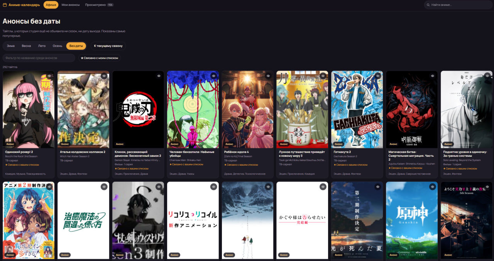
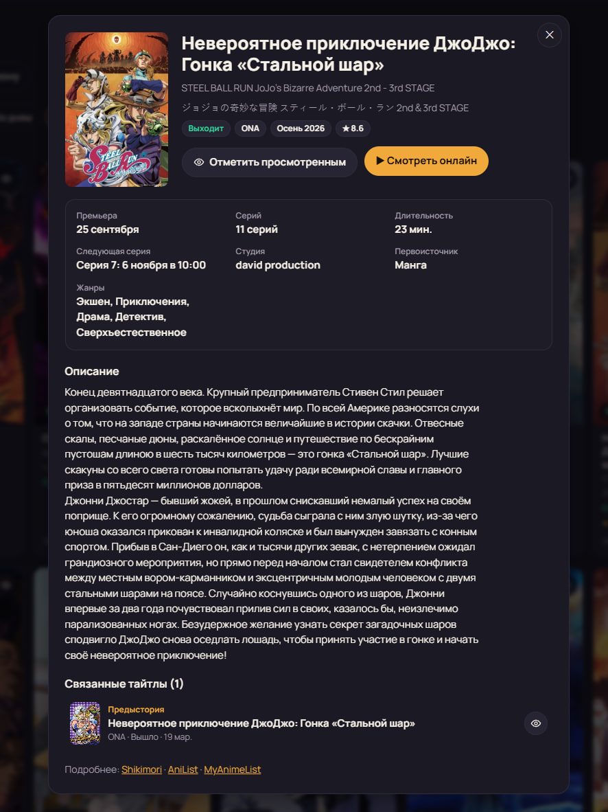
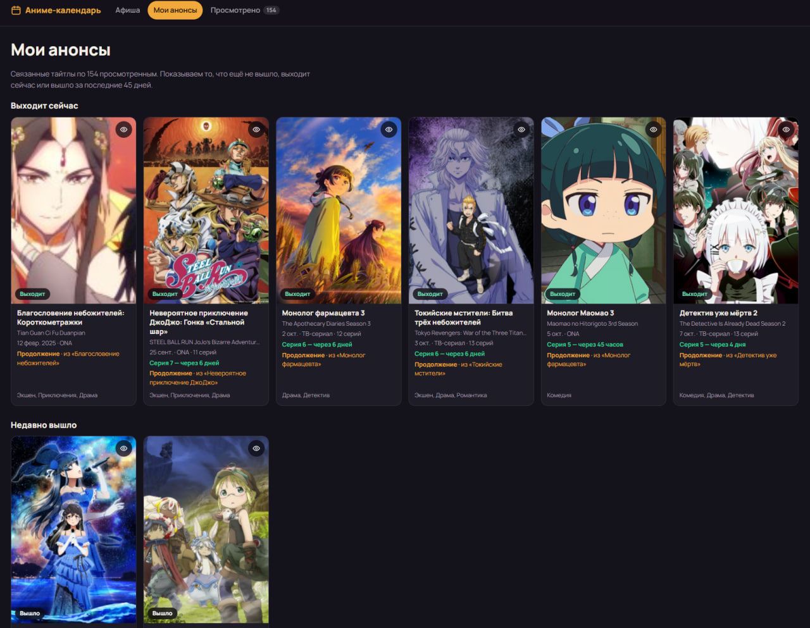
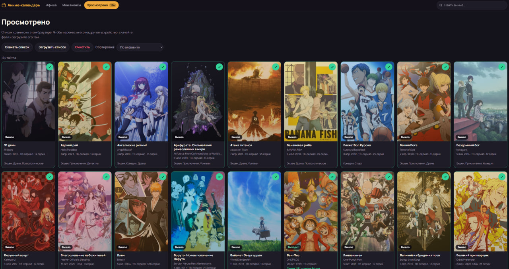

# Anime Calendar

[](LICENSE)


A Russian-language anime release calendar in the spirit of livechart.me: seasonal schedule by premiere day, announcements without a date, search, a watched list, and tracking of sequels and movies related to what you have watched. The interface is in Russian; this README is in English.

## Screenshots

| Schedule ("Афиша") | Announcements without a date |
| --- | --- |
|  |  |

| Title card | My announcements |
| --- | --- |
|  |  |

**Watched list**



## Features

- **Schedule ("Афиша").** Winter / Spring / Summer / Fall of any year (1980 to the current year + 2). Titles are grouped by premiere day, with sorting by popularity, a format filter (TV, movies, ONA/OVA) and a name filter inside the season. For the current season the page scrolls to the nearest day on its own. Next to the seasons there is a "Без даты" (no date) tab: announcements whose studio has not named a season or release date yet (the most popular ones; the list refreshes every 6 hours).
- **Search.** By Russian title, English title and romaji. It understands Russian grammatical cases and "ё". Suggestions appear as you type in the header, and Enter opens the full results.
- **Watch online.** The title card has a button that opens the title's page on an external site (old.yummyani.me by default). The exact page is found through the site's API by MAL ID, or by title and year; until it is found, the button opens a search instead. See the Configuration section below.
- **Watched list.** An eye button on every card. The list is stored in the browser, and it can be downloaded as a file and uploaded on another device. You can also upload a JSON file with a list of titles (`[{"title": "..."}]` or an array of strings): the site looks each one up through its search and adds it, which takes about a second per title, and then shows which titles could not be added and why. The list can be sorted alphabetically or in the order titles were added, and cleared after a confirmation.
- **My announcements ("Мои анонсы").** Starting from your watched list, the site walks the relation graph (sequels, prequels, spin-offs, side stories, alternative versions) and shows what has not been released yet or is airing now, labelled like "Sequel · from '…'". The walk goes up to eight steps deep, so an announcement of season five, or a movie linked to the franchise through several seasons and specials, is found even if you never marked the titles in between. Titles released within the last 45 days also appear (group "Недавно вышло", recently released), and the "★" mark in the schedule is set for every related title, including ones that are already out. Large lists are walked in batches: the page keeps loading relations and extends the list by itself. New announcements are highlighted with a "Новое" (new) badge and a counter on the tab.
- **Title card.** Russian description, studio, genres, next episode date, related titles (you can move between them inside the window), and links to Shikimori, AniList and MyAnimeList.
- **Interface.** Dark theme by default and a light theme following the system setting, a layout that fills wide screens, animations (disabled automatically for users who prefer reduced motion), and keyboard-friendly dialogs.

<details>
<summary><b>Requirements</b></summary>

- **Python 3.12+** (the Docker image uses 3.13).
- **Docker and Docker Compose**, if you want to run it in a container.
- **GNU Make**, optional: the `Makefile` only wraps the commands shown below.
- **Node.js**, optional: only used by `make js-check` to syntax-check the frontend modules.
- Internet access to AniList and Shikimori, except in demo mode.

</details>

<details>
<summary><b>Quick start</b></summary>

```bash
git clone https://github.com/Redi38/animecalendar.git
cd animecalendar

make venv                 # creates .venv and installs requirements/dev.txt
cp .env.example .env      # defaults are fine for a first run
make run                  # http://localhost:8000
```

Without `make`:

```bash
python3 -m venv .venv
.venv/bin/pip install -r requirements/dev.txt
cp .env.example .env
.venv/bin/uvicorn app.web:app --reload --port 8000
```

### Demo mode (no internet)

```bash
make demo                 # made-up titles from app/demo.py, own database data/demo.db
```

Demo mode never calls external services, which makes it useful for looking at the interface, for screenshots and for development on a machine without internet access.

### Docker

```bash
cp .env.example .env
make up                   # docker compose up -d --build, http://localhost:8030
make logs                 # follow the logs
make down                 # stop
```

`docker-compose.yml` publishes container port 8000 as **8030** on the host and mounts `./data` as `/app/data`, so the SQLite cache survives rebuilds. The image runs as an unprivileged user and has a health check on `/healthz`.

To update a running deployment:

```bash
git pull
docker compose up -d --build
```

### Behind a reverse proxy

Set `TRUST_PROXY_HEADERS=true` so the rate limiter sees real client addresses instead of the proxy's. Example for Caddy:

```
anime.example.com {
    reverse_proxy localhost:8030
}
```

Only enable `TRUST_PROXY_HEADERS` when the app is reachable exclusively through the proxy; otherwise clients can spoof `X-Forwarded-For`.

### Warm-up and first requests

With `PREWARM=true` the app loads the current and the next season and the "no date" list at startup, so the first visitor does not have to wait. A request for a "cold" season takes a few seconds (AniList returns 50 titles per request and the client keeps a polite pause between requests); later ones are served from the cache.

</details>

<details>
<summary><b>Configuration</b></summary>

Settings are read from environment variables or from `.env` (see [`.env.example`](.env.example)).

| Variable | Default | Description |
| --- | --- | --- |
| `DB_PATH` | `data/anime.db` | SQLite cache file. Docker overrides it to `/app/data/anime.db`. |
| `LOG_LEVEL` | `INFO` | Python logging level. |
| `ANILIST_URL` | `https://graphql.anilist.co` | AniList GraphQL endpoint. |
| `SHIKIMORI_BASE` | `https://shikimori.io` | Shikimori base URL (Russian titles and descriptions). |
| `SHIKIMORI_ENABLED` | `true` | `false` shows original titles and skips Shikimori entirely. |
| `HTTP_USER_AGENT` | `anime-calendar-ru/1.0` | User-Agent sent to external APIs. |
| `ALLOW_ADULT` | `false` | Include 18+ titles and genres Shikimori hides by default (yaoi, yuri, hentai) in search, watched-list import and related announcements. The season schedule always stays free of adult content. |
| `WATCH_URL` | `https://old.yummyani.me/search?word={q}` | Fallback search link for "Смотреть онлайн"; `{q}` is replaced with the title. Empty hides the button. |
| `WATCH_API` | `https://old.yummyani.me/api` | API used to find the exact page. Empty disables the exact lookup. |
| `WATCH_ITEM_URL` | `https://old.yummyani.me/catalog/item/{slug}` | Page address template; `{slug}` comes from the API. |
| `WATCH_TOKEN` | empty | Optional application token, sent as `X-Application`. |
| `TRUST_PROXY_HEADERS` | `false` | Take the client IP from `X-Forwarded-For` (only behind a proxy). |
| `PREWARM` | `true` | Load the current and next season at startup. |
| `DEMO_MODE` | `false` | Use made-up titles and no external API calls. |

The "watch online" site is an external, unofficial service. To use another one, change the three `WATCH_*` addresses; nothing else is tied to it.

</details>

<details>
<summary><b>How it works</b></summary>

```
Browser (ES modules, no build step)
   │  JSON over HTTP
   ▼
FastAPI routes ──► Catalog service ──► SQLite cache (aiosqlite)
                        │
                        ├─► AniList client   (GraphQL: seasons, dates, relations, Latin search)
                        ├─► Shikimori client (Russian titles/descriptions, Cyrillic search)
                        └─► Watch-site client (exact page lookup for "Смотреть онлайн")
```

**Data sources.** AniList provides the structure of the catalog (seasons, dates, formats, covers, relations). Shikimori provides Russian titles, Russian descriptions and Cyrillic search. Titles are linked by MAL ID (`idMal` in AniList equals the ID on Shikimori). A season on the site is the premiere season as AniList defines it, and long-runners that started earlier are not repeated in the season grid.

**Caching.** Everything fetched is saved to SQLite. If an external API fails, the site serves what is in the cache; if Shikimori is down, original titles are shown.

| Data | Refreshed after |
| --- | --- |
| Current season | 3 hours |
| Next two seasons | 6 hours |
| Further future seasons, previous season | 24 hours |
| Older seasons | 14 days |
| "No date" announcements | 6 hours |
| Relations of airing and announced titles | 12 hours |
| Relations of finished titles | 14 days |
| Missing Russian title / description | re-checked after 7 / 14 days |
| Exact "watch" page lookups | 24 hours (misses: 30 minutes) |

**Politeness to external APIs.** The AniList client keeps at least 0.75 s between requests and gives up after a long `Retry-After`; the Shikimori client keeps 0.7 s. Expensive endpoints have a per-IP sliding-window rate limit (in memory), because every visitor shares one upstream quota.

**Related announcements.** The graph walk lives in `app/services/related.py`: it follows sequel, prequel, side-story, spin-off and parent links up to 8 steps, takes "alternative version", "summary" and "compilation" links only as end points (so unrelated franchises do not merge), and ignores adaptations and character links. A single `/api/related` call fetches at most 150 titles from AniList; when that is not enough the response has `incomplete: true` and the page repeats the request every few seconds, continuing where the previous call stopped.

**"No date" announcements.** AniList cannot filter for "no date", so the server scans the 500 most popular not-yet-released titles and keeps those with neither a season nor a year.

**Frontend.** Plain ES modules in `app/web/static/js`, hash-based routing (`#/season/2026/fall`, `#/tba`, `#/watched`, `#/upcoming`, `#/title/<id>`), no bundler. Data from external APIs is inserted into the DOM as text only, never as HTML. The watched list and view preferences are kept in `localStorage`; the server stores no user data.

</details>

<details>
<summary><b>HTTP API</b></summary>

All endpoints are under `/api`. Interactive documentation is at `/docs` (FastAPI's Swagger UI).

| Method and path | Description |
| --- | --- |
| `GET /api/meta` | Current season, year range, season labels, demo flag, "watch online" settings. |
| `GET /api/season/{year}/{season}` | Cards of a season (`winter`, `spring`, `summer`, `fall`). |
| `GET /api/tba` | Announcements without a season or date. |
| `GET /api/title/{id}` | Full title card with relations. |
| `GET /api/title/{id}/watch` | Exact page of the title on the watch site (`{"url": ...}` or `null`). 30 requests per minute. |
| `GET /api/search?q=...&deep=` | Search by title; `deep=true` also asks AniList/Shikimori. 60 requests per minute. |
| `POST /api/titles` | Cards by a list of IDs (`{"ids": [...]}`, up to 500). 30 requests per minute. |
| `POST /api/related` | Related announcements for watched IDs. Returns `items`, `linked`, `degraded` and `incomplete`. Rate limited per IP. |
| `GET /healthz` | Health check used by Docker. |

</details>

<details>
<summary><b>Development</b></summary>

```bash
make ci                   # ruff, mypy, JS syntax check, tests
make test                 # tests only
make lint                 # ruff check + format check
make typecheck            # mypy
make js-check             # node --check for every frontend module
make help                 # list all targets
```

The tests run on the made-up data in `app/demo.py` with fake provider clients and make no network requests. The provider that talks to the watch site is tested with `httpx.MockTransport`.

Project layout:

```
app/
  providers/   AniList, Shikimori and watch-site clients (rate limits, retries, soft errors)
  services/    catalog.py (cache, seasons, search, relations), related.py (graph walk), dto.py
  web/         FastAPI app, routes and static files
    static/    index.html, css/app.css, js/ (main.js, api.js, store.js, ui/, views/)
  config.py    settings from the environment
  db.py        SQLite access via aiosqlite
  seasons.py   season arithmetic and cache lifetimes
  ratelimit.py per-IP sliding-window limiter
  demo.py      made-up catalog for the demo and tests
docs/screenshots/   images used by this README
tests/
```

Code style is enforced by `ruff` (line length 120) and `mypy`; there is no JS toolchain, so frontend modules are checked with `node --check`.

</details>

<details>
<summary><b>Troubleshooting</b></summary>

- **The first load of a season is slow.** That is AniList paging at 50 titles per request. It happens once per season and cache lifetime; `PREWARM=true` hides it for the current and next season.
- **"Сервис каталога (AniList) сейчас недоступен" (HTTP 503).** AniList is down or rate limiting. Cached data is still served; try again in a minute.
- **Russian titles are missing.** Check `SHIKIMORI_ENABLED` and that the server can reach Shikimori; the site falls back to original titles.
- **A title cannot be found when importing a list.** Titles are matched through search. Names that differ a lot from Shikimori's Russian names may not match; the report on screen lists every title that was not added. Titles from adult or BL genres need `ALLOW_ADULT=true`.
- **"Мои анонсы" is empty or still loading.** For long lists the first run takes a minute or two (relations are fetched in batches). The page shows a note and fills in by itself.
- **The "Смотреть онлайн" button opens a search instead of the title page.** The exact page was not found through the site's API. Check the server log for lines starting with `watch:`.
- **Port already in use.** Change the port in the `uvicorn` command or in `docker-compose.yml`.

</details>

<details>
<summary><b>Limitations</b></summary>

- The watched list holds at most 500 titles (the limit of a single API request).
- There are no accounts: the list lives in the browser. Moving it between devices is done with a file.
- The episode schedule ("Серия N — через …", episode N in ...) comes from AniList and exists only for airing titles.
- The external APIs were unreachable from the sandbox where the project was written, so the integration with live AniList, Shikimori and the watch site was checked against their documentation and on fixtures, not live. Before publishing, run `make run` once on a machine with internet access and open the current season.

</details>

## License

[MIT](LICENSE). Anime data belongs to AniList and Shikimori and is subject to their terms; cover images belong to their rights holders.
